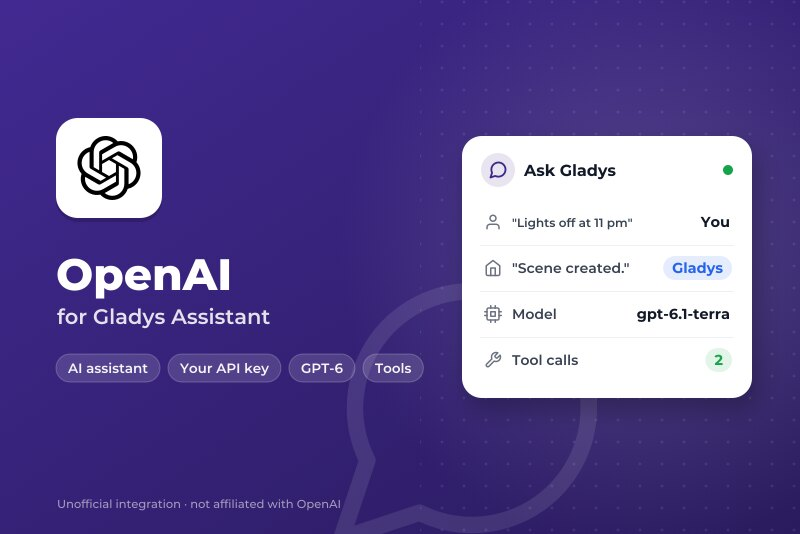
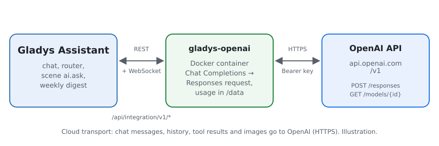
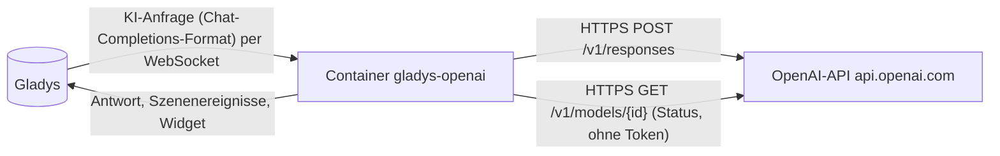
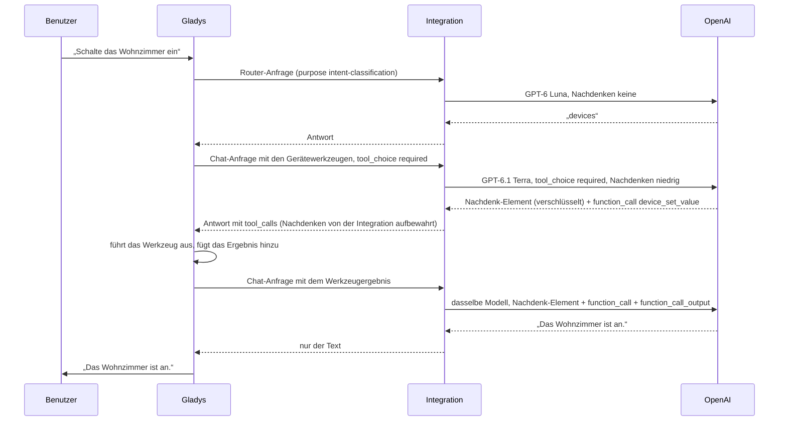
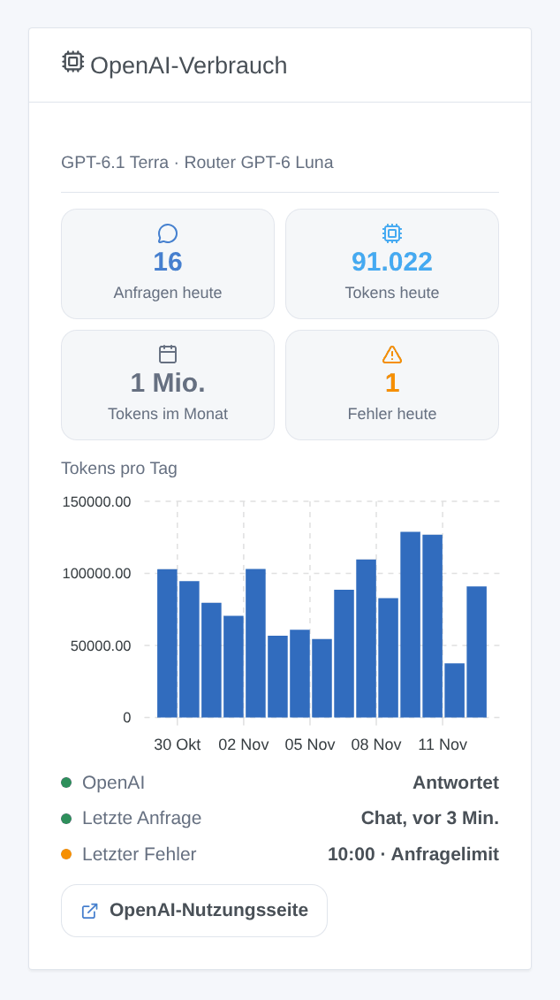

# Gladys OpenAI

[English](README.md) · [Français](README.fr.md) · **Deutsch** · [Español](README.es.md)

[](LICENSE)
[](https://github.com/William-De71/gladys-openai/releases)
[](https://github.com/William-De71/gladys-openai/actions/workflows/release.yml)
[](https://gladysassistant.com)



Externe Integration für [Gladys Assistant](https://gladysassistant.com), die den Assistenten von Gladys mit den **GPT-Modellen von OpenAI** betreibt, über die offizielle OpenAI-API (Responses API) und deinen eigenen API-Schlüssel. Sobald OpenAI unter Einstellungen → Künstliche Intelligenz ausgewählt ist, beantwortet es den Chat, steuert deine Geräte, erstellt Szenen, beantwortet die Szenenaktion „die KI fragen“ und schreibt den Wochenrückblick — ohne Gladys-Plus-Konto: Du bezahlst OpenAI direkt, nach Nutzung.

Benutzerdokumentation: [English](docs/en.md) · [Français](docs/fr.md) · [Deutsch](docs/de.md) · [Español](docs/es.md).

Nicht mit OpenAI verbunden. **Noch nicht mit einem echten OpenAI-Schlüssel getestet**: Die Anfragen folgen der offiziellen API-Referenz von OpenAI, und die Tests laufen gegen eine gefälschte API. Rückmeldungen sind willkommen.

## Funktionen

- **KI-Anbieter** (`type: "ai"`, Gladys 5.3+): Alle KI-Anfragen von Gladys gehen an OpenAI — der Chat mit seinen Werkzeugaufrufen, der Absicht-Router, die Szenenaktion „die KI fragen“, der Wochenrückblick.
- **Zwei Modelle**: ein Chat-Modell (standardmäßig GPT-6.1 Terra) und ein schnelles Router-Modell (standardmäßig GPT-6 Luna), oder jede andere OpenAI-Modell-ID.
- **Nachdenkstufe** des Chat-Modells (keine, niedrig, mittel, hoch), angepasst an das, was jedes Modell akzeptiert.
- **Nachdenken bleibt erhalten** zwischen den Werkzeugaufrufen eines Durchgangs: Die verschlüsselten Nachdenk-Elemente werden zurückgegeben, wie OpenAI es empfiehlt.
- **Szenenauslöser**: Der Assistent schlägt fehl (Schlüssel abgelehnt, Guthaben oder Ausgabenlimit, Anfragelimit, Modell nicht verfügbar, API nicht erreichbar) und antwortet wieder — einmal pro Ausfall.
- **Dashboard-Widget**: Anfragen und Tokens des Tages und des Monats, Tokens pro Tag über 30 Tage, letzte Antwort und letzter Fehler.
- Schaltfläche **Verbindung testen**; die Konfigurationsseite zeigt, ob OpenAI den Schlüssel und die Modelle akzeptiert.
- Anfragen mit abgeschalteter Speicherung (`store: false`). Englisch, Französisch, Deutsch und Spanisch.

## Funktionsweise





Die gesamte agentische Schleife (Prompts, Werkzeuge, Verlauf, Verkleinerung der Bilder) bleibt in Gladys; die Integration übersetzt jede Anfrage und ihre Antwort:



Warum die Responses API: Gladys spricht das Chat-Completions-Format, aber die GPT-6-Modelle rufen Werkzeuge mit Nachdenken nur über die Responses API auf. Was die Übersetzung übernimmt: Nachrichten als `message`-Elemente, Werkzeugaufrufe als `function_call`-Elemente und ihre Ergebnisse als `function_call_output`-Elemente (über `call_id` zugeordnet, eine Platzhalter-ID von Gladys durch eine stabile ersetzt, ein Aufruf ohne Ergebnis geschlossen), Bilder aus Data-URLs nach `input_image`, die Werkzeuge abgeflacht und mit `strict: false` gesendet (der strikte Modus würde die Schemas von Gladys umschreiben), `max_tokens` nach `max_output_tokens`, die Antwort zurück zu einer einzigen Completion mit dem Verbrauch. Ein Anfragelimit oder ein 5xx wird erneut versucht, solange die Wartezeit des Kerns es erlaubt (18 s für den Router, 110 s für den Chat), unter Beachtung von `Retry-After`; ein 429 wegen der Abrechnung (kein Guthaben, Ausgabenlimit) schlägt sofort fehl.

**Nachdenk-Elemente**: Mit `store: false` gibt ein Nachdenk-Modell sein Nachdenken verschlüsselt zurück, und OpenAI verlangt, es mit den Werkzeugergebnissen desselben Durchgangs zurückzugeben. Gladys behält nur die Chat-Completions-Felder: Die Integration merkt sich diese Elemente daher im Speicher, pro Werkzeugaufruf-ID, sechs Stunden lang, und setzt sie wieder ein. Ein Aufruf, den sie nie gesehen hat (nach einem Neustart oder bei einem Verlauf eines anderen Anbieters), geht ohne sie: akzeptiert, auf Kosten etwas Qualität.

### Transport

`transports: ["cloud"]`: Alles geht per HTTPS an `api.openai.com`, der Schlüssel im Header `Authorization`. **OpenAI sieht jede Chat-Nachricht, den Verlauf, die Definitionen und Ergebnisse der Werkzeuge (den Zustand der Geräte, die es abfragt) und die Bilder des Chats**, und seine Antworten steuern deine Geräte und Szenen. OpenAI trainiert nicht mit API-Daten, außer du stimmst zu; Antworten werden nicht gespeichert (`store: false`), aber Protokolle zur Missbrauchsüberwachung werden bis zu 30 Tage aufbewahrt. Gladys weicht nie auf Gladys Plus aus, wenn OpenAI fehlschlägt: Der Chat sagt, was nicht stimmt. `/data` speichert nur die Zähler des Widgets.

## Modelle

| Modell         | API-ID          | Verwendung                                                            | Nachdenken                            | Preis Ein- / Ausgabe pro 1 Mio. Tokens |
| -------------- | --------------- | --------------------------------------------------------------------- | ------------------------------------- | -------------------------------------- |
| GPT-6.1 Terra  | `gpt-6.1-terra` | Chat (Standard): schnell, gut mit Werkzeugen und klaren Texten        | keine bis hoch                        | $1 / $5                                |
| GPT-6.1 Sol    | `gpt-6.1-sol`   | Chat: bei komplexen Anfragen nahe an Astra                            | niedrig bis hoch                      | $2 / $10                               |
| GPT-6 Astra    | `gpt-6-astra`   | Chat: am leistungsfähigsten                                           | niedrig bis hoch                      | $10 / $50                              |
| GPT-6 Luna     | `gpt-6-luna`    | Router (Standard) oder günstiger Chat: unter den 20 s, die es bekommt | keine bis hoch                        | $0.10 / $0.50                          |
| GPT-5.6 Terra  | `gpt-5.6-terra` | Chat: die vorherige Generation                                        | keine bis hoch                        | $2 / $12                               |
| GPT-5.6 Luna   | `gpt-5.6-luna`  | Router: die vorherige Generation                                      | keine bis hoch                        | $0.20 / $1.20                          |
| Anderes Modell | deine ID        | Ein neueres Modell, ein Snapshot: Es muss Funktionen aufrufen         | wie gewünscht, entfällt bei Ablehnung | —                                      |

IDs, Nachdenkstufen und Preise am 5. November 2026 in der Dokumentation der OpenAI-API geprüft. `xhigh` und `max` gibt es, aber sie sind für einen Hausassistenten zu langsam: Sie werden nicht angeboten.

## Szenen und Widget



- **Auslöser „OpenAI: Der Assistent schlägt fehl“**: Variablen `kind` (`auth`, `billing`, `rate_limit`, `model`, `unreachable`, `timeout`, `server`), `message`, `use`, `model`; Filter nach Art. Eine abgelehnte Anfrage (HTTP 400, eine Ablehnung, eine von den Sicherheitssystemen gestoppte Antwort) betrifft nur sie und löst nichts aus.
- **Auslöser „OpenAI: Der Assistent antwortet wieder“**: Variable `down_minutes`.
- **Widget „OpenAI-Verbrauch“**: von der Integration aus dem `usage` jeder Antwort gezählt, Nachdenken inklusive; Anfragen außerhalb von Gladys mit demselben Schlüssel sind nicht enthalten. Die Seite Usage der OpenAI-Plattform bleibt die Referenz für die Rechnung.
- **Keine Websuche-Aktion**: OpenAI verlangt, Web-Ergebnisse mit ihren Quellenangaben als gut sichtbare, anklickbare Links anzuzeigen; eine Szene, die die Antwort vorliest oder per SMS sendet, kann das nicht.

Beispiele:

- _Wenn der Assistent fehlschlägt_ (Art `billing`) → eine Telegram-Nachricht mit `{{triggerEvent.data.message}}` an den Administrator senden.
- _Wenn der Assistent wieder antwortet_ → „OpenAI ist nach `{{triggerEvent.data.down_minutes}}` Min. zurück“ senden.

## Voraussetzungen

- Gladys Assistant **5.3.0** oder neuer (KI-Anbieter); ältere Instanzen können die Integration nicht installieren.
- Ein Konto auf der [OpenAI-Plattform](https://platform.openai.com) mit vorausbezahltem Guthaben und ein API-Schlüssel.

### Kosten und Limits

- **Bezahlung nach Nutzung**: kein kostenloser Tarif für die API. Ein Chat-Durchgang von Gladys macht mindestens zwei Anfragen (Router, dann Chat), mehr, wenn Werkzeuge aufgerufen werden; Nachdenk-Tokens werden als Ausgabe abgerechnet, und zwischengespeicherte Prompt-Tokens kosten ein Zehntel oder weniger.
- **Ausgabenlimits**: Lege unter Limits ein monatliches Budget und Warnungen fest. Wenn das Guthaben oder ein Limit aufgebraucht ist, antwortet OpenAI mit einem 429 mit Abrechnungscode: Die Integration versucht es nicht erneut, und der Auslöser `error` wird mit der Art `billing` ausgelöst.
- **Anfragelimits** hängen von der Nutzungsstufe des Kontos ab und steigen mit den Ausgaben; ein 429 wird innerhalb der Zeit, die Gladys wartet, erneut versucht, eine längere von OpenAI verlangte Wartezeit schlägt sofort mit ihrem Grund fehl.
- OpenAI veröffentlicht eine Liste unterstützter Länder; von anderswo antwortet die API mit 403.

## Installation

- **Aus dem Store**: Integrationen → OpenAI → Installieren.
- **Über die URL des Repositorys**: Integrationen → externe Integration → `https://github.com/William-De71/gladys-openai`.
- **Entwicklermodus**: Starte `npm start` mit den Variablen, die Gladys bereitstellt (siehe Entwicklung).

## Konfiguration

| Feld oder Schaltfläche | Standard      | Bedeutung                                                                     |
| ---------------------- | ------------- | ----------------------------------------------------------------------------- |
| OpenAI-API-Schlüssel   | —             | Pflicht, geheim: wird nie wieder angezeigt und nie protokolliert              |
| Chat-Modell            | GPT-6.1 Terra | Chat, Erstellen von Szenen, Wochenrückblick                                   |
| Router-Modell          | GPT-6 Luna    | Ordnet jede Nachricht vor der Antwort ein, innerhalb von 20 s                 |
| ID des anderen Modells | —             | Wird verwendet, wenn ein Modell auf „Anderes Modell“ steht                    |
| Nachdenken             | niedrig       | Des Chat-Modells; der Router nimmt die niedrigste Stufe, die sein Modell kann |
| Maximale Antwortlänge  | 16000 Tokens  | Nachdenken inklusive; erhöhen, wenn die Protokolle max_tokens melden          |
| Verbindung testen      | —             | Eine kurze Antwort jedes Modells mit ihrer Dauer (ein paar Tokens)            |

## Verwendung

1. In Gladys (Integrationen → OpenAI → Konfiguration): Füge den API-Schlüssel ein, wähle die Modelle und drücke **Verbindung testen**.
2. Einstellungen → **Künstliche Intelligenz**: Wähle **OpenAI** als Anbieter.
3. Sprich im Chat mit Gladys; füge das Widget einem Dashboard hinzu; nutze die Auslöser in deinen Szenen.

## Entwicklung

```bash
npm install
npm test                       # node --test, eine gefälschte OpenAI-API auf 127.0.0.1, nie das Netzwerk
npm run lint                   # ESLint
npm run format:check           # Prettier
npx github:GladysAssistant/integration-store . --skip-image-check
scripts/build-cover.sh         # cover.jpg aus docs/assets/cover.svg
docs/illustrations/render.sh   # docs/assets/widgets.<lang>.png
```

Lokal liest das SDK `GLADYS_HOST_API_URL`, `GLADYS_INTEGRATION_TOKEN` und `GLADYS_INTEGRATION_SELECTOR` (von Gladys im Entwicklermodus bereitgestellt), und die Integration liest `TZ`. `DEBUG=gladys-integration-sdk` zeigt die Protokolle des SDK.

Die Tests decken den HTTP-Client (Fehler, Abrechnungscodes, Wiederholungen, Fristen), die Übersetzung in beide Richtungen (`validateAiCompletion` des SDK), die Zuordnung von Aufrufen und Ergebnissen, die Nachdenk-Elemente, den Chat-Handler (Modelle pro Zweck, Nachdenken, abgelehnter Parameter, Ablehnungen, abgeschnittene Antworten), die Auslöser, die Verbrauchszähler, das Widget (`validateWidgetContent`), das Manifest, die vier Sprachen, das Release-Skript und die ganze Integration gegen das gefälschte Gladys des SDK ab. `test/structure.test.js` friert alle Schlüssel ein, die Benutzer speichern.

## Release-Prozess


Jede Zusammenführung auf `main` startet die CI und berechnet dann die Version aus den [Conventional Commits](https://www.conventionalcommits.org/) seit dem letzten Tag: `feat` → Minor, `fix` / `perf` → Patch, `!` oder `BREAKING CHANGE` → Major (ein Minor vor 1.0.0); `docs`, `chore`, `ci`, `test`, `style`, `refactor`, `build` allein veröffentlichen nichts. Der Changelog-Abschnitt wird erzeugt, der Tag gepusht, das Multi-Architektur-Image gebaut, dann erhält `main` den Release-Commit, das GitHub Release wird erstellt und ein letzter Job prüft das öffentliche Image, den Store-Validator und das Topic.

- Der Titel des Pull Requests wird zum Squash-Commit und dann zur Changelog-Zeile: Schreibe ihn auf Englisch, für den Benutzer (`pr-title.yml` prüft ihn). Bearbeite `CHANGELOG.md` nie von Hand.
- 1.0.0 ist eine Entscheidung: Actions → Release → Run workflow mit `release-as: 1.0.0`. `dry-run` zeigt Version und Notizen, ohne etwas zu veröffentlichen.
- **Geschützter Branch**: Das Release pusht seinen Commit mit `GITHUB_TOKEN` auf `main`. Das Ruleset `protect-main` (weder Löschen noch Force-Push) lässt ihn durch; eine strengere Regel (Pull Request Pflicht, Status Checks) bräuchte GitHub Actions in der Bypass-Liste oder eine GitHub App.
- Mache nach dem ersten Release das Paket `ghcr.io` öffentlich (Package settings → Change visibility), sonst kann Gladys es nicht herunterladen.

## Fehlerbehebung

Siehe [docs/de.md](docs/de.md#fehlerbehebung). Melde Probleme mit den Versionen von Gladys und der Integration, den gewählten Modellen, deinem Land und deiner Nutzungsstufe und der Meldung von **Verbindung testen**. Füge niemals deinen API-Schlüssel ein.

## Mitwirken

Issues und Pull Requests sind willkommen, vor allem von Leuten mit einem OpenAI-Schlüssel: Eine fehlschlagende Anfrage (ohne den Schlüssel) hilft sehr. Führe `npm run format:check && npm run lint && npm test` aus, bevor du einen Pull Request öffnest, und ändere keinen gespeicherten Schlüssel (siehe [CLAUDE.md](CLAUDE.md)).

## Sicherheit

Siehe [SECURITY.md](SECURITY.md): Melde Sicherheitslücken vertraulich. Der API-Schlüssel ist ein `secret`-Feld: nie protokolliert, nie in `/data` geschrieben, nur per HTTPS in einem Header an `api.openai.com` gesendet; ein in einer Fehlermeldung zitierter Schlüssel wird maskiert.

## Kommende Screenshots

Die Bilder oben sind Illustrationen, keine Screenshots. Echte Screenshots kommen nach `docs/assets/screenshots/` (PNG, 1280 × 800): `configuration.png` (die Konfiguration mit ihrem Status), `ai-settings.png` (OpenAI unter Einstellungen → Künstliche Intelligenz gewählt), `chat.png` (ein Chat, der ein Gerät einschaltet).

## Lizenz

[Apache License 2.0](LICENSE) — siehe auch [NOTICE](NOTICE). OpenAI, GPT und ChatGPT sind Marken von OpenAI; dieses Projekt ist nicht mit OpenAI verbunden und wird von OpenAI weder unterstützt noch gesponsert. Danke an die Dokumentation und das SDK von Gladys sowie an die Dokumentation der OpenAI-API.
