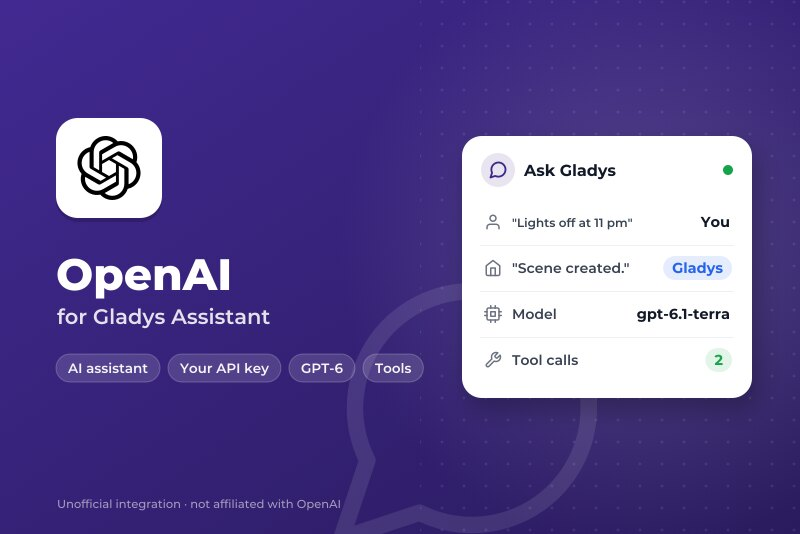
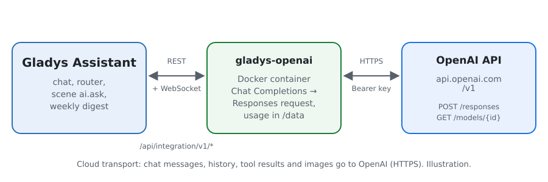
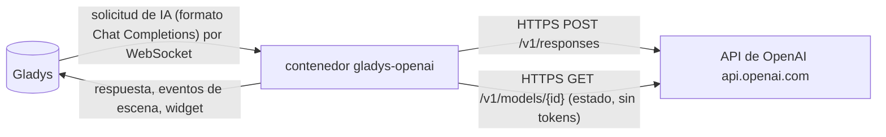
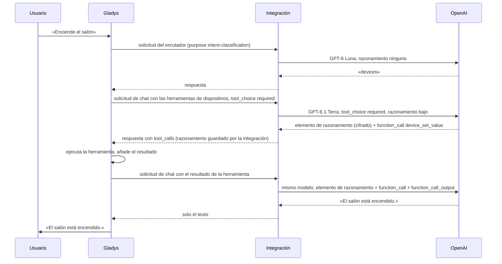
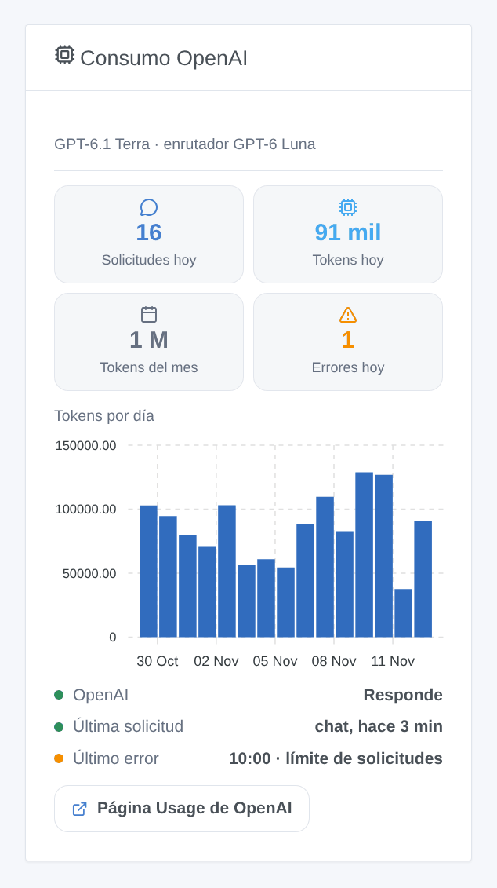

# Gladys OpenAI

[English](README.md) · [Français](README.fr.md) · [Deutsch](README.de.md) · **Español**

[](LICENSE)
[](https://github.com/William-De71/gladys-openai/releases)
[](https://github.com/William-De71/gladys-openai/actions/workflows/release.yml)
[](https://gladysassistant.com)



Integración externa de [Gladys Assistant](https://gladysassistant.com) que hace funcionar el asistente de Gladys con los **modelos GPT de OpenAI**, a través de la API oficial de OpenAI (Responses API) y su propia clave de API. Una vez elegido en Ajustes → Inteligencia artificial, OpenAI responde al chat, controla sus dispositivos, crea escenas, responde a la acción de escena «preguntar a la IA» y redacta el resumen semanal — sin cuenta Gladys Plus: usted paga directamente a OpenAI, según el uso.

Documentación de usuario: [English](docs/en.md) · [Français](docs/fr.md) · [Deutsch](docs/de.md) · [Español](docs/es.md).

No afiliada a OpenAI. **Todavía no probada con una clave real de OpenAI**: las solicitudes siguen la referencia oficial de la API de OpenAI, y las pruebas se ejecutan contra una API falsa. Sus comentarios son bienvenidos.

## Funciones

- **Proveedor de IA** (`type: "ai"`, Gladys 5.3+): todas las solicitudes de IA de Gladys van a OpenAI — el chat con sus llamadas a herramientas, el enrutador de intenciones, la acción de escena «preguntar a la IA», el resumen semanal.
- **Dos modelos**: un modelo de chat (GPT-6.1 Terra por defecto) y un modelo de enrutador rápido (GPT-6 Luna por defecto), o cualquier otro identificador de modelo de OpenAI.
- **Nivel de razonamiento** del modelo del chat (ninguno, bajo, medio, alto), adaptado a lo que acepta cada modelo.
- **Razonamiento conservado** entre las llamadas a herramientas de un turno: los elementos de razonamiento cifrados se devuelven, como aconseja OpenAI.
- **Desencadenantes de escena**: el asistente falla (clave rechazada, créditos o límite de gasto, límite de solicitudes, modelo no disponible, API inaccesible) y vuelve a responder — una vez por fallo.
- **Widget de panel**: solicitudes y tokens del día y del mes, tokens por día durante 30 días, última respuesta y último error.
- Botón **Probar la conexión**; la pantalla de configuración indica si OpenAI acepta la clave y los modelos.
- Solicitudes enviadas con el almacenamiento desactivado (`store: false`). Inglés, francés, alemán y español.

## Funcionamiento





Todo el bucle agéntico (prompts, herramientas, historial, redimensionado de imágenes) se queda en Gladys; la integración traduce cada solicitud y su respuesta:



Por qué la Responses API: Gladys habla el formato Chat Completions, pero los modelos GPT-6 solo llaman a herramientas con razonamiento a través de la Responses API. Lo que gestiona la traducción: los mensajes a elementos `message`, las llamadas a herramientas a elementos `function_call` y sus resultados a elementos `function_call_output` (emparejados por `call_id`, un identificador provisional de Gladys sustituido por uno estable, una llamada que quedó sin resultado cerrada), las imágenes en data URL a `input_image`, las herramientas aplanadas y enviadas con `strict: false` (el modo estricto reescribiría los esquemas de Gladys), `max_tokens` a `max_output_tokens`, la respuesta convertida de nuevo en una sola completion con el consumo. Un límite de solicitudes o un 5xx se reintenta mientras el tiempo de espera del núcleo lo permita (18 s para el enrutador, 110 s para el chat), respetando `Retry-After`; un 429 de facturación (sin crédito, límite de gasto) falla al instante.

**Elementos de razonamiento**: con `store: false`, un modelo de razonamiento devuelve su razonamiento cifrado, y OpenAI pide devolverlo con los resultados de herramientas del mismo turno. Gladys solo conserva los campos de Chat Completions: la integración guarda por tanto estos elementos en memoria, por identificador de llamada a herramienta, durante seis horas, y los vuelve a poner. Una llamada que nunca ha visto (tras un reinicio, o un historial producido por otro proveedor) se envía sin ellos: se acepta, a costa de algo de calidad.

### Transporte

`transports: ["cloud"]`: todo va a `api.openai.com` por HTTPS, la clave en la cabecera `Authorization`. **OpenAI ve cada mensaje del chat, el historial, las definiciones y resultados de las herramientas (el estado de los dispositivos que consulta) y las imágenes del chat**, y sus respuestas controlan sus dispositivos y escenas. OpenAI no entrena con los datos de la API salvo que usted lo acepte; las respuestas no se almacenan (`store: false`), pero los registros de supervisión de abusos se conservan hasta 30 días. Gladys nunca recurre a Gladys Plus cuando OpenAI falla: el chat dice qué ocurre. `/data` solo guarda los contadores del widget.

## Modelos

| Modelo        | Identificador de API | Uso                                                                        | Razonamiento                            | Precio entrada / salida por 1 M de tokens |
| ------------- | -------------------- | -------------------------------------------------------------------------- | --------------------------------------- | ----------------------------------------- |
| GPT-6.1 Terra | `gpt-6.1-terra`      | Chat (por defecto): rápido, bueno con herramientas y redacción clara       | de ninguno a alto                       | $1 / $5                                   |
| GPT-6.1 Sol   | `gpt-6.1-sol`        | Chat: cercano a Astra en solicitudes complejas                             | de bajo a alto                          | $2 / $10                                  |
| GPT-6 Astra   | `gpt-6-astra`        | Chat: el más capaz                                                         | de bajo a alto                          | $10 / $50                                 |
| GPT-6 Luna    | `gpt-6-luna`         | Enrutador (por defecto) o chat económico: dentro de los 20 s que se le dan | de ninguno a alto                       | $0.10 / $0.50                             |
| GPT-5.6 Terra | `gpt-5.6-terra`      | Chat: la generación anterior                                               | de ninguno a alto                       | $2 / $12                                  |
| GPT-5.6 Luna  | `gpt-5.6-luna`       | Enrutador: la generación anterior                                          | de ninguno a alto                       | $0.20 / $1.20                             |
| Otro modelo   | su identificador     | Un modelo más reciente, un snapshot: debe llamar a funciones               | según lo pedido, se quita si se rechaza | —                                         |

Identificadores, niveles de razonamiento y precios comprobados en la documentación de la API de OpenAI el 5 de noviembre de 2026. `xhigh` y `max` existen, pero son demasiado lentos para un asistente doméstico: no se ofrecen.

## Escenas y widget



- **Desencadenante «OpenAI: el asistente falla»**: variables `kind` (`auth`, `billing`, `rate_limit`, `model`, `unreachable`, `timeout`, `server`), `message`, `use`, `model`; filtro por tipo. Una solicitud rechazada (HTTP 400, una negativa, una respuesta detenida por los sistemas de seguridad) solo le concierne a ella y no desencadena nada.
- **Desencadenante «OpenAI: el asistente vuelve a responder»**: variable `down_minutes`.
- **Widget «Consumo OpenAI»**: contado por la integración a partir del `usage` de cada respuesta, razonamiento incluido; las solicitudes hechas fuera de Gladys con la misma clave no están incluidas. La página Usage de la plataforma de OpenAI sigue siendo la referencia para la factura.
- **Sin acción de búsqueda web**: OpenAI exige mostrar los resultados web con sus citas como enlaces visibles y en los que se pueda hacer clic; una escena que lee la respuesta en voz alta o la envía por SMS no puede hacerlo.

Ejemplos:

- _Cuando el asistente falla_ (tipo `billing`) → enviar un mensaje de Telegram al administrador con `{{triggerEvent.data.message}}`.
- _Cuando el asistente vuelve a responder_ → enviar «OpenAI ha vuelto tras `{{triggerEvent.data.down_minutes}}` min».

## Requisitos previos

- Gladys Assistant **5.3.0** o posterior (proveedores de IA); las instancias más antiguas no pueden instalar la integración.
- Una cuenta en la [plataforma de OpenAI](https://platform.openai.com) con créditos de prepago, y una clave de API.

### Costes y límites

- **Pago por uso**: sin nivel gratuito en la API. Un turno de chat de Gladys hace al menos dos solicitudes (enrutador y luego chat), más cuando se llaman herramientas; los tokens de razonamiento se facturan como salida, y los tokens de prompt en caché cuestan una décima parte o menos.
- **Límites de gasto**: fije un presupuesto mensual y alertas en Limits. Cuando se agotan los créditos o un límite, OpenAI responde un 429 con un código de facturación: la integración no reintenta y el desencadenante `error` se activa con el tipo `billing`.
- **Los límites de solicitudes** dependen del nivel de uso de la cuenta y suben con el gasto; un 429 se reintenta dentro del tiempo que Gladys espera, una espera más larga pedida por OpenAI falla al instante con su motivo.
- OpenAI publica una lista de países admitidos; desde otros lugares, la API responde 403.

## Instalación

- **Desde la tienda**: Integraciones → OpenAI → Instalar.
- **Desde la URL del repositorio**: Integraciones → integración externa → `https://github.com/William-De71/gladys-openai`.
- **Modo desarrollador**: ejecute `npm start` con las variables que da Gladys (ver Desarrollo).

## Configuración

| Campo o botón                    | Por defecto   | Significado                                                            |
| -------------------------------- | ------------- | ---------------------------------------------------------------------- |
| Clave de API de OpenAI           | —             | Obligatoria, secreta: nunca se vuelve a mostrar ni se registra         |
| Modelo del chat                  | GPT-6.1 Terra | Chat, creación de escenas, resumen semanal                             |
| Modelo del enrutador             | GPT-6 Luna    | Clasifica cada mensaje antes de la respuesta, en menos de 20 s         |
| Identificador del otro modelo    | —             | Se usa cuando un modelo está en «Otro modelo»                          |
| Razonamiento                     | bajo          | Del modelo del chat; el enrutador usa el más bajo que acepta su modelo |
| Longitud máxima de una respuesta | 16000 tokens  | Razonamiento incluido; auméntela si los registros indican max_tokens   |
| Probar la conexión               | —             | Una respuesta corta de cada modelo, con su tiempo (algunos tokens)     |

## Uso

1. En Gladys (Integraciones → OpenAI → Configuración): pegue la clave de API, elija los modelos y pulse **Probar la conexión**.
2. Ajustes → **Inteligencia artificial**: elija **OpenAI** como proveedor.
3. Hable con Gladys en el chat; añada el widget a un panel; use los desencadenantes en sus escenas.

## Desarrollo

```bash
npm install
npm test                       # node --test, una API de OpenAI falsa en 127.0.0.1, nunca la red
npm run lint                   # ESLint
npm run format:check           # Prettier
npx github:GladysAssistant/integration-store . --skip-image-check
scripts/build-cover.sh         # cover.jpg a partir de docs/assets/cover.svg
docs/illustrations/render.sh   # docs/assets/widgets.<lang>.png
```

En local, el SDK lee `GLADYS_HOST_API_URL`, `GLADYS_INTEGRATION_TOKEN` y `GLADYS_INTEGRATION_SELECTOR` (que Gladys da en modo desarrollador), y la integración lee `TZ`. `DEBUG=gladys-integration-sdk` muestra los registros del SDK.

Las pruebas cubren el cliente HTTP (errores, códigos de facturación, reintentos, plazos), la traducción en ambos sentidos (`validateAiCompletion` del SDK), el emparejamiento de llamadas y resultados, los elementos de razonamiento, el gestor del chat (modelos por uso, razonamiento, parámetro rechazado, negativas, respuestas cortadas), los desencadenantes, los contadores de consumo, el widget (`validateWidgetContent`), el manifiesto, los cuatro idiomas, el script de release y toda la integración contra el Gladys falso del SDK. `test/structure.test.js` congela todas las claves que guardan los usuarios.

## Proceso de release


Cada fusión en `main` lanza la CI y calcula la versión a partir de los [Conventional Commits](https://www.conventionalcommits.org/) desde la última etiqueta: `feat` → menor, `fix` / `perf` → parche, `!` o `BREAKING CHANGE` → mayor (una menor antes de 1.0.0); `docs`, `chore`, `ci`, `test`, `style`, `refactor`, `build` solos no publican nada. Se genera la sección del changelog, se sube la etiqueta, se construye la imagen multiarquitectura, luego `main` recibe el commit de release, se crea la GitHub Release y un último job comprueba la imagen pública, el validador de la tienda y el topic.

- El título de la pull request se convierte en el commit squash y luego en la línea del changelog: escríbalo en inglés, para el usuario (`pr-title.yml` lo comprueba). Nunca edite `CHANGELOG.md` a mano.
- 1.0.0 es una decisión: Actions → Release → Run workflow con `release-as: 1.0.0`. `dry-run` muestra la versión y las notas sin publicar nada.
- **Rama protegida**: la release sube su commit a `main` con `GITHUB_TOKEN`. El ruleset `protect-main` (ni borrado ni force-push) lo deja pasar; una regla más estricta (pull request obligatoria, status checks) necesitaría GitHub Actions en su lista de omisión, o una GitHub App.
- Tras la primera release, haga público el paquete `ghcr.io` (Package settings → Change visibility), o Gladys no podrá descargarlo.

## Solución de problemas

Vea [docs/es.md](docs/es.md#solución-de-problemas). Informe de los problemas con las versiones de Gladys y de la integración, los modelos elegidos, su país y su nivel de uso, y el mensaje de **Probar la conexión**. Nunca pegue su clave de API.

## Contribuir

Las issues y pull requests son bienvenidas, sobre todo de personas con una clave de OpenAI: una solicitud que falla (sin la clave) ayuda mucho. Ejecute `npm run format:check && npm run lint && npm test` antes de abrir una pull request, y no cambie ninguna clave guardada (vea [CLAUDE.md](CLAUDE.md)).

## Seguridad

Vea [SECURITY.md](SECURITY.md): informe de las vulnerabilidades en privado. La clave de API es un campo `secret`: nunca se registra, nunca se escribe en `/data`, solo se envía a `api.openai.com` por HTTPS, en una cabecera; una clave citada en un mensaje de error se enmascara.

## Capturas pendientes

Las imágenes anteriores son ilustraciones, no capturas de pantalla. Las capturas reales irán en `docs/assets/screenshots/` (PNG, 1280 × 800): `configuration.png` (la configuración con su estado), `ai-settings.png` (OpenAI elegido en Ajustes → Inteligencia artificial), `chat.png` (un chat que enciende un dispositivo).

## Licencia

[Licencia Apache 2.0](LICENSE) — vea también [NOTICE](NOTICE). OpenAI, GPT y ChatGPT son marcas de OpenAI; este proyecto no está afiliado a OpenAI ni cuenta con su respaldo o patrocinio. Gracias a la documentación y al SDK de Gladys, y a la documentación de la API de OpenAI.
