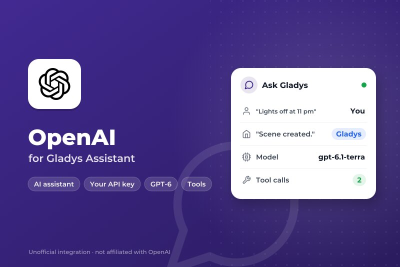
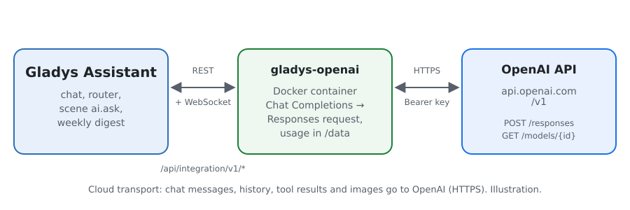
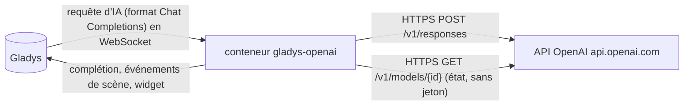
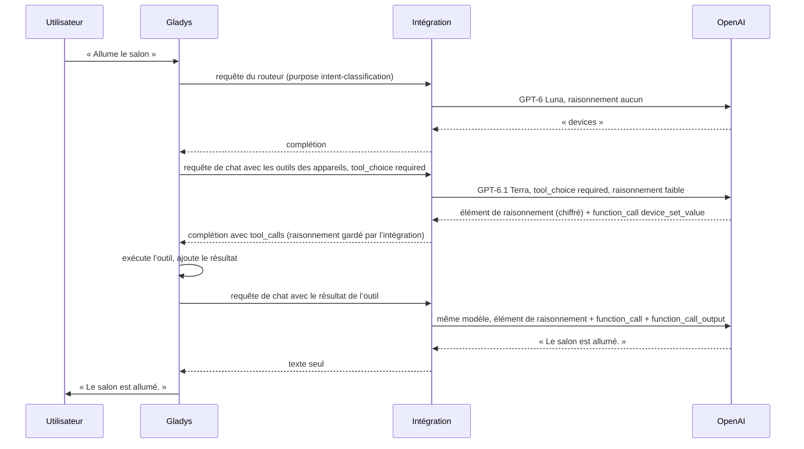
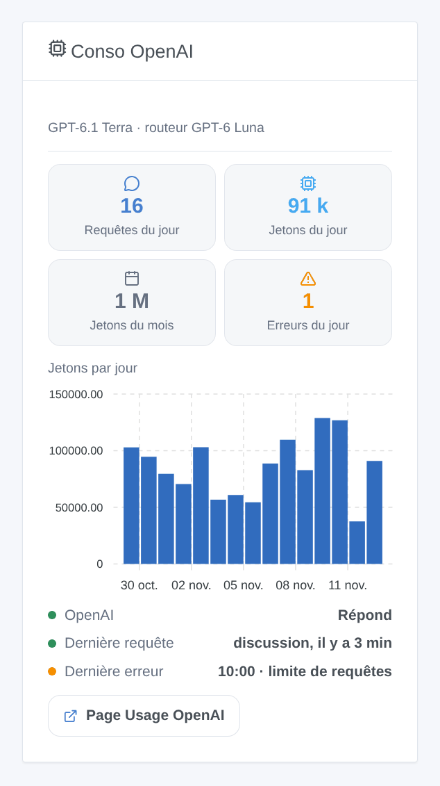

# Gladys OpenAI

[English](README.md) · **Français** · [Deutsch](README.de.md) · [Español](README.es.md)

[](LICENSE)
[](https://github.com/William-De71/gladys-openai/releases)
[](https://github.com/William-De71/gladys-openai/actions/workflows/release.yml)
[](https://gladysassistant.com)



Intégration externe de [Gladys Assistant](https://gladysassistant.com) qui fait tourner l’assistant de Gladys sur les **modèles GPT d’OpenAI**, via l’API OpenAI officielle (Responses API) et votre propre clé d’API. Une fois choisi dans Paramètres → Intelligence artificielle, OpenAI répond au chat, pilote vos appareils, crée des scènes, répond à l’action de scène « demander à l’IA » et rédige le résumé hebdomadaire — sans compte Gladys Plus : vous payez OpenAI directement, à l’usage.

Documentation utilisateur : [English](docs/en.md) · [Français](docs/fr.md) · [Deutsch](docs/de.md) · [Español](docs/es.md).

Non affiliée à OpenAI. **Pas encore testée avec une vraie clé OpenAI** : les requêtes suivent la référence officielle de l’API OpenAI, et les tests tournent contre une fausse API. Vos retours sont les bienvenus.

## Fonctionnalités

- **Fournisseur d’IA** (`type: "ai"`, Gladys 5.3+) : toutes les requêtes d’IA de Gladys partent vers OpenAI — le chat et ses appels d’outils, le routeur d’intention, l’action de scène « demander à l’IA », le résumé hebdomadaire.
- **Deux modèles** : un modèle de chat (GPT-6.1 Terra par défaut) et un modèle de routeur rapide (GPT-6 Luna par défaut), ou tout autre identifiant de modèle OpenAI.
- **Niveau de raisonnement** du modèle du chat (aucun, faible, moyen, élevé), adapté à ce que chaque modèle accepte.
- **Raisonnement conservé** entre les appels d’outils d’un tour : les éléments de raisonnement chiffrés sont renvoyés, comme OpenAI le conseille.
- **Déclencheurs de scène** : l’assistant est en erreur (clé refusée, crédits ou plafond de dépenses, limite de requêtes, modèle indisponible, API injoignable) et répond de nouveau — une fois par panne.
- **Widget de tableau de bord** : requêtes et jetons du jour et du mois, jetons par jour sur 30 jours, dernière réponse et dernière erreur.
- Bouton **Tester la connexion** ; l’écran de configuration indique si OpenAI accepte la clé et les modèles.
- Requêtes envoyées avec le stockage coupé (`store: false`). Anglais, français, allemand et espagnol.

## Fonctionnement





Toute la boucle agentique (prompts, outils, historique, redimensionnement des images) reste dans Gladys ; l’intégration traduit chaque requête et sa réponse :



Pourquoi la Responses API : Gladys parle le format Chat Completions, mais les modèles GPT-6 n’appellent des outils avec raisonnement que via la Responses API. Ce que gère la traduction : les messages vers des éléments `message`, les appels d’outils vers des éléments `function_call` et leurs résultats vers des éléments `function_call_output` (appariés par `call_id`, un identifiant provisoire de Gladys remplacé par un identifiant stable, un appel resté sans résultat refermé), les images en data URL vers `input_image`, les outils aplatis et envoyés avec `strict: false` (le mode strict réécrirait les schémas de Gladys), `max_tokens` vers `max_output_tokens`, la réponse ramenée à une seule complétion avec la consommation. Une limite de requêtes ou une 5xx est retentée tant que le temps d’attente du cœur le permet (18 s pour le routeur, 110 s pour le chat), en respectant `Retry-After` ; une 429 de facturation (plus de crédit, plafond de dépenses) échoue tout de suite.

**Éléments de raisonnement** : avec `store: false`, un modèle à raisonnement renvoie son raisonnement chiffré, et OpenAI demande de le repasser avec les résultats d’outils du même tour. Gladys ne garde que les champs Chat Completions : l’intégration mémorise donc ces éléments, en mémoire, par identifiant d’appel d’outil, pendant six heures, et les remet en place. Un appel qu’elle n’a jamais vu (après un redémarrage, ou un historique produit par un autre fournisseur) part sans eux : c’est accepté, au prix d’un peu de qualité.

### Transport

`transports: ["cloud"]` : tout part vers `api.openai.com` en HTTPS, la clé dans l’en-tête `Authorization`. **OpenAI voit chaque message du chat, l’historique, les définitions et résultats des outils (l’état des appareils qu’il consulte) et les images du chat**, et ses réponses pilotent vos appareils et vos scènes. OpenAI n’entraîne pas ses modèles sur les données de l’API sauf si vous l’acceptez ; les réponses ne sont pas stockées (`store: false`), mais les journaux de surveillance des abus sont gardés jusqu’à 30 jours. Gladys ne se replie jamais sur Gladys Plus quand OpenAI échoue : le chat dit ce qui ne va pas. `/data` ne garde que les compteurs du widget.

## Modèles

| Modèle        | Identifiant d’API | Usage                                                                | Raisonnement                    | Prix entrée / sortie par million de jetons |
| ------------- | ----------------- | -------------------------------------------------------------------- | ------------------------------- | ------------------------------------------ |
| GPT-6.1 Terra | `gpt-6.1-terra`   | Chat (défaut) : rapide, bon avec les outils et en rédaction claire   | d’aucun à élevé                 | $1 / $5                                    |
| GPT-6.1 Sol   | `gpt-6.1-sol`     | Chat : proche d’Astra sur les demandes complexes                     | de faible à élevé               | $2 / $10                                   |
| GPT-6 Astra   | `gpt-6-astra`     | Chat : le plus capable                                               | de faible à élevé               | $10 / $50                                  |
| GPT-6 Luna    | `gpt-6-luna`      | Routeur (défaut) ou chat économique : sous les 20 s qu’on lui laisse | d’aucun à élevé                 | $0.10 / $0.50                              |
| GPT-5.6 Terra | `gpt-5.6-terra`   | Chat : la génération précédente                                      | d’aucun à élevé                 | $2 / $12                                   |
| GPT-5.6 Luna  | `gpt-5.6-luna`    | Routeur : la génération précédente                                   | d’aucun à élevé                 | $0.20 / $1.20                              |
| Autre modèle  | votre identifiant | Un modèle plus récent, un snapshot : il doit appeler des fonctions   | comme demandé, retiré si refusé | —                                          |

Identifiants, niveaux de raisonnement et prix vérifiés dans la documentation de l’API OpenAI le 5 novembre 2026. `xhigh` et `max` existent mais sont trop lents pour un assistant domestique : ils ne sont pas proposés.

## Scènes et widget



- **Déclencheur « OpenAI : l’assistant est en erreur »** : variables `kind` (`auth`, `billing`, `rate_limit`, `model`, `unreachable`, `timeout`, `server`), `message`, `use`, `model` ; filtre par type. Une requête refusée (HTTP 400, un refus, une réponse arrêtée par les systèmes de sécurité) ne concerne qu’elle et ne déclenche rien.
- **Déclencheur « OpenAI : l’assistant répond de nouveau »** : variable `down_minutes`.
- **Widget « Conso OpenAI »** : compté par l’intégration à partir du `usage` de chaque réponse, raisonnement compris ; les requêtes faites hors de Gladys avec la même clé n’y sont pas. La page Usage de la plateforme OpenAI reste la référence pour la facture.
- **Pas d’action de recherche web** : OpenAI impose d’afficher les résultats web avec leurs citations sous forme de liens visibles et cliquables ; une scène qui lit la réponse à voix haute ou l’envoie par SMS ne le peut pas.

Exemples :

- _Quand l’assistant est en erreur_ (type `billing`) → envoyer un message Telegram à l’administrateur avec `{{triggerEvent.data.message}}`.
- _Quand l’assistant répond de nouveau_ → envoyer « OpenAI est revenu après `{{triggerEvent.data.down_minutes}}` min ».

## Prérequis

- Gladys Assistant **5.3.0** ou plus récent (fournisseurs d’IA) ; les instances plus anciennes ne peuvent pas installer l’intégration.
- Un compte sur la [plateforme OpenAI](https://platform.openai.com) avec des crédits prépayés, et une clé d’API.

### Coûts et limites

- **Paiement à l’usage** : pas d’offre gratuite sur l’API. Un tour de chat de Gladys fait au moins deux requêtes (routeur, puis chat), davantage quand des outils sont appelés ; les jetons de raisonnement sont facturés en sortie, et les jetons de prompt en cache coûtent un dixième ou moins.
- **Plafonds de dépenses** : fixez un budget mensuel et des alertes dans Limits. Quand les crédits ou un plafond sont épuisés, OpenAI répond une 429 avec un code de facturation : l’intégration ne retente pas et le déclencheur `error` part avec le type `billing`.
- **Les limites de requêtes** dépendent du palier d’usage du compte et montent avec les dépenses ; une 429 est retentée dans le temps que Gladys attend, une attente plus longue demandée par OpenAI échoue tout de suite avec sa raison.
- OpenAI publie une liste des pays pris en charge ; depuis ailleurs, l’API répond 403.

## Installation

- **Depuis le store** : Intégrations → OpenAI → Installer.
- **Depuis l’URL du dépôt** : Intégrations → intégration externe → `https://github.com/William-De71/gladys-openai`.
- **Mode développeur** : lancez `npm start` avec les variables fournies par Gladys (voir Développement).

## Configuration

| Champ ou bouton                 | Défaut        | Rôle                                                                       |
| ------------------------------- | ------------- | -------------------------------------------------------------------------- |
| Clé d’API OpenAI                | —             | Obligatoire, secrète : plus jamais affichée, jamais journalisée            |
| Modèle du chat                  | GPT-6.1 Terra | Chat, création de scènes, résumé hebdomadaire                              |
| Modèle du routeur               | GPT-6 Luna    | Trie chaque message avant la réponse, en moins de 20 s                     |
| Identifiant de l’autre modèle   | —             | Utilisé quand un modèle est réglé sur « Autre modèle »                     |
| Raisonnement                    | faible        | Du modèle du chat ; le routeur prend le plus faible que son modèle accepte |
| Longueur maximale d’une réponse | 16000 jetons  | Raisonnement compris ; à augmenter si les journaux signalent max_tokens    |
| Tester la connexion             | —             | Une courte réponse de chaque modèle, avec son temps (quelques jetons)      |

## Utilisation

1. Dans Gladys (Intégrations → OpenAI → Configuration) : collez la clé d’API, choisissez les modèles ; appuyez sur **Tester la connexion**.
2. Paramètres → **Intelligence artificielle** : choisissez **OpenAI** comme fournisseur.
3. Parlez à Gladys dans le chat ; ajoutez le widget à un tableau de bord ; utilisez les déclencheurs dans vos scènes.

## Développement

```bash
npm install
npm test                       # node --test, une fausse API OpenAI sur 127.0.0.1, jamais le réseau
npm run lint                   # ESLint
npm run format:check           # Prettier
npx github:GladysAssistant/integration-store . --skip-image-check
scripts/build-cover.sh         # cover.jpg depuis docs/assets/cover.svg
docs/illustrations/render.sh   # docs/assets/widgets.<lang>.png
```

En local, le SDK lit `GLADYS_HOST_API_URL`, `GLADYS_INTEGRATION_TOKEN` et `GLADYS_INTEGRATION_SELECTOR` (fournies par Gladys en mode développeur), et l’intégration lit `TZ`. `DEBUG=gladys-integration-sdk` affiche les journaux du SDK.

Les tests couvrent le client HTTP (erreurs, codes de facturation, relances, délais), la conversion dans les deux sens (`validateAiCompletion` du SDK), l’appariement des appels et des résultats, les éléments de raisonnement, le gestionnaire de chat (modèles par usage, raisonnement, paramètre refusé, refus, réponses coupées), les déclencheurs, les compteurs de consommation, le widget (`validateWidgetContent`), le manifeste, les quatre langues, le script de release, et toute l’intégration contre le faux Gladys du SDK. `test/structure.test.js` fige toutes les clés que les utilisateurs enregistrent.

## Processus de release


Chaque fusion sur `main` lance la CI, puis calcule la version d’après les [Conventional Commits](https://www.conventionalcommits.org/) depuis le dernier tag : `feat` → mineure, `fix` / `perf` → correctif, `!` ou `BREAKING CHANGE` → majeure (une mineure avant 1.0.0) ; `docs`, `chore`, `ci`, `test`, `style`, `refactor`, `build` seuls ne publient rien. La section du changelog est générée, le tag poussé, l’image multi-architecture construite, puis `main` reçoit le commit de release, la GitHub Release est créée et un dernier job vérifie l’image publique, le validateur du store et le topic.

- Le titre de la pull request devient le commit squash, puis la ligne du changelog : écrivez-le en anglais, pour l’utilisateur (`pr-title.yml` le vérifie). N’éditez jamais `CHANGELOG.md` à la main.
- 1.0.0 est une décision : Actions → Release → Run workflow avec `release-as: 1.0.0`. `dry-run` affiche la version et les notes sans rien publier.
- **Branche protégée** : la release pousse son commit sur `main` avec `GITHUB_TOKEN`. Le ruleset `protect-main` (ni suppression ni force-push) le laisse passer ; une règle plus stricte (pull request obligatoire, status checks) demanderait GitHub Actions dans sa liste de contournement, ou une GitHub App.
- Après la première release, rendez public le package `ghcr.io` (Package settings → Change visibility), sinon Gladys ne peut pas le télécharger.

## Dépannage

Voir [docs/fr.md](docs/fr.md#dépannage). Signalez les problèmes avec les versions de Gladys et de l’intégration, les modèles choisis, votre pays et votre palier d’usage, et le message de **Tester la connexion**. Ne collez jamais votre clé d’API.

## Contribuer

Issues et pull requests bienvenues, surtout de la part de personnes qui ont une clé OpenAI : une requête qui échoue (sans la clé) aide beaucoup. Lancez `npm run format:check && npm run lint && npm test` avant d’ouvrir une pull request, et ne changez aucune clé enregistrée (voir [CLAUDE.md](CLAUDE.md)).

## Sécurité

Voir [SECURITY.md](SECURITY.md) : signalez les vulnérabilités en privé. La clé d’API est un champ `secret` : jamais journalisée, jamais écrite dans `/data`, envoyée seulement à `api.openai.com` en HTTPS, dans un en-tête ; une clé citée dans un message d’erreur est masquée.

## Captures à venir

Les images ci-dessus sont des illustrations, pas des captures d’écran. Les vraies captures iront dans `docs/assets/screenshots/` (PNG, 1280 × 800) : `configuration.png` (la configuration avec son état), `ai-settings.png` (OpenAI choisi dans Paramètres → Intelligence artificielle), `chat.png` (un chat qui allume un appareil).

## Licence

[Licence Apache 2.0](LICENSE) — voir aussi [NOTICE](NOTICE). OpenAI, GPT et ChatGPT sont des marques d’OpenAI ; ce projet n’est ni affilié à OpenAI, ni approuvé ou soutenu par OpenAI. Merci à la documentation et au SDK de Gladys, et à la documentation de l’API OpenAI.
