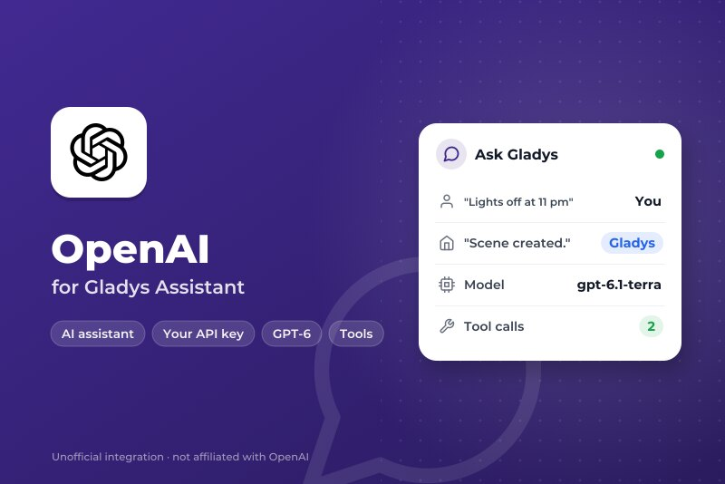
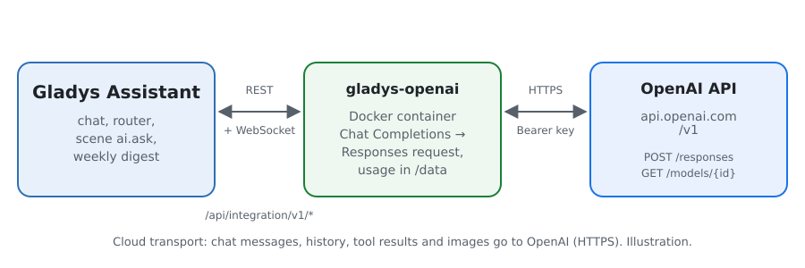
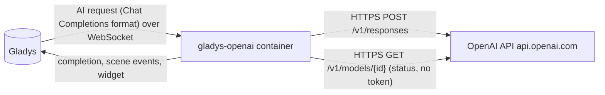
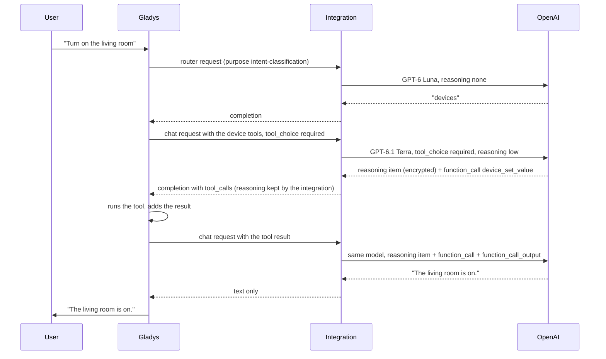
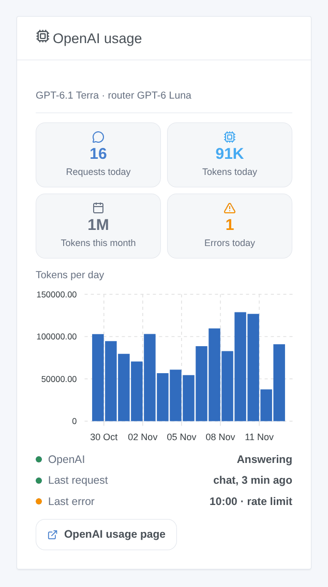

# Gladys OpenAI

**English** · [Français](README.fr.md) · [Deutsch](README.de.md) · [Español](README.es.md)

[](LICENSE)
[](https://github.com/William-De71/gladys-openai/releases)
[](https://github.com/William-De71/gladys-openai/actions/workflows/release.yml)
[](https://gladysassistant.com)



[Gladys Assistant](https://gladysassistant.com) external integration that runs the assistant of Gladys on the **GPT models of OpenAI**, through the official OpenAI API (Responses API) and your own API key. Once selected in Settings → Artificial Intelligence, OpenAI answers the chat, controls your devices, creates scenes, answers the "ask the AI" scene action and writes the weekly digest — without a Gladys Plus account: you pay OpenAI directly, per use.

User documentation: [English](docs/en.md) · [Français](docs/fr.md) · [Deutsch](docs/de.md) · [Español](docs/es.md).

Not affiliated with OpenAI. **Not tested with a real OpenAI key yet**: the requests follow the official API reference of OpenAI, and the tests run against a fake API. Feedback welcome.

## Features

- **AI provider** (`type: "ai"`, Gladys 5.3+): every AI request of Gladys goes to OpenAI — the chat with its tool calls, the intent router, the scene "ask the AI" action, the weekly digest.
- **Two models**: a chat model (GPT-6.1 Terra by default) and a fast router model (GPT-6 Luna by default), or any other OpenAI model id.
- **Reasoning effort** of the chat model (none, low, medium, high), adapted to what each model accepts.
- **Reasoning kept** between the tool calls of a turn: the encrypted reasoning items are passed back, as OpenAI advises.
- **Scene triggers**: the assistant fails (key refused, credits or spend limit, rate limit, model unavailable, API unreachable) and answers again — once per failure.
- **Dashboard widget**: requests and tokens of the day and of the month, tokens per day over 30 days, last answer and last error.
- **Test the connection** button; the configuration screen shows whether OpenAI accepts the key and the models.
- Requests sent with storage off (`store: false`). English, French, German and Spanish.

## How it works





The whole agentic loop (prompts, tools, history, image resizing) stays in Gladys; the integration translates each request and its answer:



Why the Responses API: Gladys speaks the Chat Completions format, but the GPT-6 models only call tools with reasoning through the Responses API. The translation handles: messages to `message` items, tool calls to `function_call` items and their results to `function_call_output` items (paired by `call_id`, a placeholder id of Gladys replaced by a stable one, a call left without a result closed), images from data URLs to `input_image`, the tools flattened and sent with `strict: false` (strict mode would rewrite the schemas of Gladys), `max_tokens` to `max_output_tokens`, the answer back to one completion with the usage. A rate limit or a 5xx is retried while the time the core waits allows it (18 s for the router, 110 s for the chat), honouring `Retry-After`; a billing 429 (no credit, spend limit) fails at once.

**Reasoning items**: with `store: false`, a reasoning model returns its reasoning encrypted, and OpenAI asks to pass it back with the tool results of the same turn. Gladys only keeps the Chat Completions fields, so the integration remembers these items in memory, by tool call id, for six hours, and puts them back. A call it never saw (after a restart, or a history made by another provider) goes without them: accepted, at some cost in quality.

### Transport

`transports: ["cloud"]`: everything goes to `api.openai.com` over HTTPS, the key in the `Authorization` header. **OpenAI sees every chat message, the history, the tool definitions and results (the state of the devices it reads) and the chat images**, and its answers drive your devices and scenes. OpenAI does not train on API data unless you opt in; responses are not stored (`store: false`), but abuse monitoring logs are kept up to 30 days. Gladys never falls back to Gladys Plus when OpenAI fails: the chat says what is wrong. `/data` only keeps the usage counters of the widget.

## Models

| Model         | API id          | Use                                                        | Reasoning                    | Price in / out per 1M tokens |
| ------------- | --------------- | ---------------------------------------------------------- | ---------------------------- | ---------------------------- |
| GPT-6.1 Terra | `gpt-6.1-terra` | Chat (default): fast, good at tools and clear writing      | none to high                 | $1 / $5                      |
| GPT-6.1 Sol   | `gpt-6.1-sol`   | Chat: close to Astra on complex requests                   | low to high                  | $2 / $10                     |
| GPT-6 Astra   | `gpt-6-astra`   | Chat: the most capable                                     | low to high                  | $10 / $50                    |
| GPT-6 Luna    | `gpt-6-luna`    | Router (default) or cheap chat: under the 20 s it is given | none to high                 | $0.10 / $0.50                |
| GPT-5.6 Terra | `gpt-5.6-terra` | Chat: the previous generation                              | none to high                 | $2 / $12                     |
| GPT-5.6 Luna  | `gpt-5.6-luna`  | Router: the previous generation                            | none to high                 | $0.20 / $1.20                |
| Other model   | your id         | A newer model, a snapshot: it must call functions          | as asked, dropped if refused | —                            |

Ids, reasoning levels and prices checked in the OpenAI API documentation on 5 November 2026. `xhigh` and `max` exist but are too slow for a home assistant: they are not offered.

## Scenes and widget



- **Trigger "OpenAI: the assistant fails"**: variables `kind` (`auth`, `billing`, `rate_limit`, `model`, `unreachable`, `timeout`, `server`), `message`, `use`, `model`; filter by kind. A refused request (HTTP 400, a refusal, an answer stopped by the safety systems) is about that request only and starts nothing.
- **Trigger "OpenAI: the assistant answers again"**: variable `down_minutes`.
- **Widget "OpenAI usage"**: counted by the integration from the `usage` of each answer, reasoning included; requests made outside Gladys with the same key are not in it. The Usage page of the OpenAI platform stays the reference for the bill.
- **No web search action**: OpenAI requires web results to be shown with their citations as prominent, clickable links; a scene that reads the answer aloud or sends it by SMS cannot do that.

Examples:

- _When the assistant fails_ (kind `billing`) → send a Telegram message to the administrator with `{{triggerEvent.data.message}}`.
- _When the assistant answers again_ → send "OpenAI is back after `{{triggerEvent.data.down_minutes}}` min".

## Requirements

- Gladys Assistant **5.3.0** or later (AI providers); older instances cannot install the integration.
- An account on the [OpenAI platform](https://platform.openai.com) with prepaid credits, and an API key.

### Costs and limits

- **Pay per use**: no free tier on the API. A chat turn of Gladys makes at least two requests (router, then chat), more when tools are called; reasoning tokens are billed as output, and cached prompt tokens cost a tenth or less.
- **Spend limits**: set a monthly budget and alerts in Limits. When credits or a limit run out, OpenAI answers a 429 with a billing code: the integration does not retry and the `error` trigger fires with the kind `billing`.
- **Rate limits** depend on the usage tier of the account and rise with the spending; a 429 is retried within the time Gladys waits, a longer wait asked by OpenAI fails at once with its reason.
- OpenAI serves a list of supported countries; from elsewhere the API answers 403.

## Installation

- **From the store**: Integrations → OpenAI → Install.
- **From the repository URL**: Integrations → external integration → `https://github.com/William-De71/gladys-openai`.
- **Developer mode**: run `npm start` with the variables given by Gladys (see Development).

## Configuration

| Field or button       | Default       | Meaning                                                               |
| --------------------- | ------------- | --------------------------------------------------------------------- |
| OpenAI API key        | —             | Required, a secret: never shown again, never logged                   |
| Chat model            | GPT-6.1 Terra | Chat, scene creation, weekly digest                                   |
| Router model          | GPT-6 Luna    | Sorts every message before the answer, within 20 s                    |
| Other model id        | —             | Used when a model is set to "Other model"                             |
| Reasoning             | low           | Of the chat model; the router uses the least its model accepts        |
| Maximum answer length | 16000 tokens  | Reasoning included; raise it if the logs say an answer hit max_tokens |
| Test the connection   | —             | One short answer from each model, with its time (spends a few tokens) |

## Usage

1. In Gladys (Integrations → OpenAI → Configuration): paste the API key, choose the models; press **Test the connection**.
2. Settings → **Artificial Intelligence**: choose **OpenAI** as the provider.
3. Talk to Gladys in the chat; add the widget to a dashboard; use the triggers in your scenes.

## Development

```bash
npm install
npm test                       # node --test, a fake OpenAI API on 127.0.0.1, never the network
npm run lint                   # ESLint
npm run format:check           # Prettier
npx github:GladysAssistant/integration-store . --skip-image-check
scripts/build-cover.sh         # cover.jpg from docs/assets/cover.svg
docs/illustrations/render.sh   # docs/assets/widgets.<lang>.png
```

Locally, the SDK reads `GLADYS_HOST_API_URL`, `GLADYS_INTEGRATION_TOKEN` and `GLADYS_INTEGRATION_SELECTOR` (given by Gladys in developer mode), and the integration reads `TZ`. `DEBUG=gladys-integration-sdk` shows the SDK logs.

The tests cover the HTTP client (errors, billing codes, retries, deadlines), the conversion both ways (`validateAiCompletion` of the SDK), the pairing of calls and results, the reasoning items, the chat handler (models per purpose, reasoning, refused parameter, refusals, cut answers), the triggers, the usage counters, the widget (`validateWidgetContent`), the manifest, the four languages, the release script, and the whole integration against the fake Gladys of the SDK. `test/structure.test.js` freezes every key users store.

## Release process


Every merge on `main` runs the CI, then computes the version from the [Conventional Commits](https://www.conventionalcommits.org/) since the last tag: `feat` → minor, `fix` / `perf` → patch, `!` or `BREAKING CHANGE` → major (a minor below 1.0.0); `docs`, `chore`, `ci`, `test`, `style`, `refactor`, `build` alone publish nothing. The changelog section is generated, the tag pushed, the multi-architecture image built, then `main` receives the release commit, the GitHub Release is created and a last job checks the public image, the store validator and the topic.

- The pull request title becomes the squash commit, then the changelog line: write it in English, for the user (`pr-title.yml` checks it). Never edit `CHANGELOG.md` by hand.
- 1.0.0 is a decision: Actions → Release → Run workflow with `release-as: 1.0.0`. `dry-run` shows the version and the notes without publishing.
- **Protected branch**: the release pushes its commit to `main` with `GITHUB_TOKEN`. The `protect-main` ruleset (no deletion, no force-push) lets it through; a stricter rule (pull request required, status checks) would need GitHub Actions in its bypass list, or a GitHub App.
- After the first release, make the `ghcr.io` package public (Package settings → Change visibility), or Gladys cannot pull it.

## Troubleshooting

See [docs/en.md](docs/en.md#troubleshooting). Report issues with the versions of Gladys and of the integration, the models chosen, your country and usage tier, and the message of **Test the connection**. Never paste your API key.

## Contributing

Issues and pull requests are welcome, especially from people with an OpenAI key: a failing request (without the key) helps a lot. Run `npm run format:check && npm run lint && npm test` before opening a pull request, and keep every stored key unchanged (see [CLAUDE.md](CLAUDE.md)).

## Security

See [SECURITY.md](SECURITY.md): report vulnerabilities privately. The API key is a `secret` field: never logged, never written to `/data`, sent only to `api.openai.com` over HTTPS, in a header; a key quoted in an error message is masked.

## Screenshots to come

The images above are illustrations, not screenshots. Real screenshots will go in `docs/assets/screenshots/` (PNG, 1280 × 800): `configuration.png` (the configuration with its status), `ai-settings.png` (OpenAI chosen in Settings → Artificial Intelligence), `chat.png` (a chat that switches a device on).

## License

[Apache License 2.0](LICENSE) — see also [NOTICE](NOTICE). OpenAI, GPT and ChatGPT are trademarks of OpenAI; this project is not affiliated with, endorsed or sponsored by OpenAI. Thanks to the Gladys documentation and SDK, and to the OpenAI API documentation.
