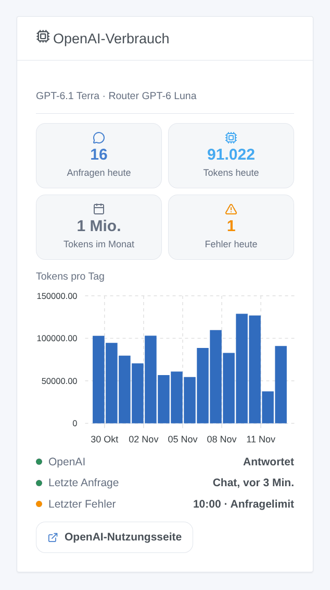

# OpenAI

## Überblick

Diese Integration betreibt den Assistenten von Gladys mit den **GPT-Modellen von OpenAI**, über die offizielle OpenAI-API (Responses-API) und deinen eigenen API-Schlüssel. Sobald du sie unter **Einstellungen → Künstliche Intelligenz** wählst, geht jede KI-Anfrage von Gladys an OpenAI: der Chat und die Geräte, die er steuert, die Szenen, die er erstellt, die Szenenaktion „die KI fragen“ und der Wochenrückblick. Sie funktioniert ohne Gladys-Plus-Konto: Du bezahlst OpenAI direkt, nach Nutzung.

Sie fügt außerdem zwei Szenenauslöser hinzu (der Assistent schlägt fehl, der Assistent antwortet wieder) und ein Dashboard-Widget deines Verbrauchs.

Nicht mit OpenAI verbunden. Noch nicht mit einem echten OpenAI-Schlüssel getestet: Rückmeldungen sind willkommen.

## Voraussetzungen

- Gladys Assistant 5.3.0 oder neuer.
- Ein Konto auf der [OpenAI-Plattform](https://platform.openai.com) mit Prepaid-Guthaben (Billing) und ein API-Schlüssel: **API keys**, **Create new secret key** (ein Projektschlüssel genügt).
- **Kosten**: Abrechnung pro Token. Mit den Standardmodellen kostet ein Chat-Austausch einen Bruchteil eines Cents; die Tokens des Nachdenkens zählen als Ausgabe. Lege unter **Limits** ein Monatsbudget und Ausgabenlimits fest: Die Integration hält dann sauber an, wenn sie erreicht sind.
- **Deine Daten**: OpenAI trainiert seine Modelle nicht mit API-Daten, außer du stimmst zu. Die Integration sendet jede Anfrage ohne Speicherung (`store: false`), aber OpenAI bewahrt Protokolle zur Missbrauchsüberwachung bis zu 30 Tage auf.
- Was dein Zuhause verlässt: jede Chat-Nachricht, der Verlauf, die Werkzeuge, die Gladys anbietet, und ihre Ergebnisse (der Zustand der Geräte, die das Modell abfragt) und die Bilder des Chats gehen per HTTPS an OpenAI. Die Antworten steuern deine Geräte und erstellen Szenen.

## Konfiguration

| Feld oder Schaltfläche         | Standard      | Bedeutung                                                                                                   |
| ------------------------------ | ------------- | ----------------------------------------------------------------------------------------------------------- |
| OpenAI-API-Schlüssel           | —             | Pflichtfeld. Wird nie wieder angezeigt, nie protokolliert                                                   |
| Chat-Modell                    | GPT-6.1 Terra | Beantwortet den Chat, erstellt Szenen, schreibt den Wochenrückblick                                         |
| Router-Modell                  | GPT-6 Luna    | Ordnet jede Nachricht vor der Antwort ein und muss innerhalb von 20 Sekunden antworten                      |
| ID des anderen Modells         | —             | Nur wenn ein Modell auf „Anderes Modell“ steht: die genaue API-ID (es muss Werkzeuge in Responses aufrufen) |
| Nachdenken des Chat-Modells    | Niedrig       | Mehr Nachdenken, bessere Szenen, langsamere und teurere Antworten                                           |
| Maximale Antwortlänge (Tokens) | 16000         | Nachdenken inbegriffen; OpenAI empfiehlt 25000, um hohes Nachdenken auszuprobieren                          |
| Verbindung testen              | —             | Eine kurze Antwort jedes Modells mit seiner Zeit; verbraucht ein paar Tokens                                |

Der Status des Konfigurationsbildschirms zeigt, ob OpenAI den Schlüssel und beide Modelle akzeptiert, ohne ein Token zu verbrauchen. Das Lesen eines Modells beweist nicht, dass das Projekt bezahlen kann (kein Guthaben mehr, Ausgabenlimit): **Verbindung testen** schon.

## Verwendung

1. Integrationen → **OpenAI** → Konfiguration: Füge den API-Schlüssel ein, behalte die Standardmodelle und drücke **Verbindung testen**.
2. Einstellungen → **Künstliche Intelligenz**: Wähle **OpenAI**.
3. Sprich im Chat mit Gladys: „Schalte das Wohnzimmer ein“, „Wie warm ist es im Schlafzimmer?“, „Erstelle eine Szene, die bei Sonnenuntergang die Rollläden schließt“.

### Die Modelle wählen

Preise pro Million Tokens, Eingabe / Ausgabe, am 5. November 2026:

- **GPT-6.1 Terra** (Standard für den Chat, 1 $ / 5 $): schnell, gut beim Aufrufen von Werkzeugen und beim klaren Schreiben.
- **GPT-6.1 Sol** (2 $ / 10 $): nah an Astra bei komplexen Anfragen.
- **GPT-6 Astra** (10 $ / 50 $): das leistungsfähigste, für lange Szenenbeschreibungen.
- **GPT-6 Luna** (Standard-Router, 0,10 $ / 0,50 $): das schnellste und günstigste; beim Erstellen von Szenen weniger zuverlässig.
- **GPT-5.6 Terra** und **GPT-5.6 Luna**: die vorige Generation, weiterhin unterstützt.
- **Anderes Modell**: ein neueres Modell oder ein datierter Snapshot. Lehnt es den Aufwand des Nachdenkens ab, sendet die Integration es von da an ohne.

GPT-6.1 Sol und GPT-6 Astra können das Nachdenken nicht abschalten: **Keines** wird bei ihnen zu **niedrig**. Der Router nutzt immer das geringste Nachdenken, das sein Modell akzeptiert.

### Dashboard-Widget

Das Widget **OpenAI-Verbrauch** zeigt die Anfragen und Tokens des Tages, die Tokens des Monats, die Fehler des Tages, die Tokens pro Tag über 30 Tage, ob OpenAI antwortet, die letzte Anfrage und den letzten Fehler. Es zählt, was Gladys angefragt hat, Nachdenken inbegriffen; die Seite Usage der OpenAI-Plattform bleibt die Referenz für die Rechnung.

### Szenen

- **Auslöser „OpenAI: Der Assistent schlägt fehl“**: einmal pro Ausfall (Schlüssel abgelehnt, Guthaben oder Ausgabenlimit, Anfragelimit, Modell nicht verfügbar, API nicht erreichbar, zu langsam, OpenAI-Fehler), mit Art, Meldung, Anfrage und Modell.
- **Auslöser „OpenAI: Der Assistent antwortet wieder“**: die erste Antwort nach einem Ausfall, mit den Minuten des Ausfalls.

Beispiele: Schlägt der Assistent wegen des Guthabens oder des Ausgabenlimits fehl, eine Telegram-Nachricht an den Administrator senden; antwortet er wieder, eine weitere mit den Minuten des Ausfalls senden.

Es gibt keine Websuche-Aktion: OpenAI verlangt, Web-Ergebnisse mit ihren Quellen als gut sichtbare, anklickbare Links anzuzeigen, was eine Szenenbenachrichtigung nicht garantieren kann.

## Fehlerbehebung

- **„OpenAI hat den API-Schlüssel abgelehnt“**: Kopiere den Schlüssel erneut von der Seite API keys; ein widerrufener Schlüssel ergibt dieselbe Meldung. Dieselbe Meldung erscheint, wenn Gladys in einem Land läuft, das OpenAI nicht bedient.
- **„OpenAI führt … nicht aus: kein Guthaben mehr oder Ausgabenlimit erreicht“**: Lade unter Billing Guthaben auf oder erhöhe das Budget unter Limits. Warten hilft nicht: Die Integration versucht es nicht erneut.
- **„Anfragelimit erreicht“**: Die Limits hängen von der Nutzungsstufe des Kontos ab und steigen mit deinen Ausgaben. Ein Chat-Austausch macht mindestens zwei Anfragen.
- **„… ist für diesen API-Schlüssel nicht verfügbar“**: Das Modell existiert nicht, wurde abgeschaltet, oder das Projekt hat keinen Zugriff; wähle ein anderes.
- **Der Chat antwortet, ohne etwas zu tun**: Probiere GPT-6.1 Terra oder 6.1 Sol mit niedrigem oder mittlerem Nachdenken; GPT-6 Luna ist mit vielen Werkzeugen weniger zuverlässig.
- **„The answer was cut at max_tokens“**: Erhöhe die maximale Antwortlänge oder verringere das Nachdenken.
- **„… refused to answer“** oder **„content_filter“**: Die Sicherheitssysteme von OpenAI haben die Anfrage oder die Antwort blockiert; formuliere sie um.
- Protokolle: Einstellungen → Überwachung, die Protokolle der Integration. Teile niemals deinen API-Schlüssel.
