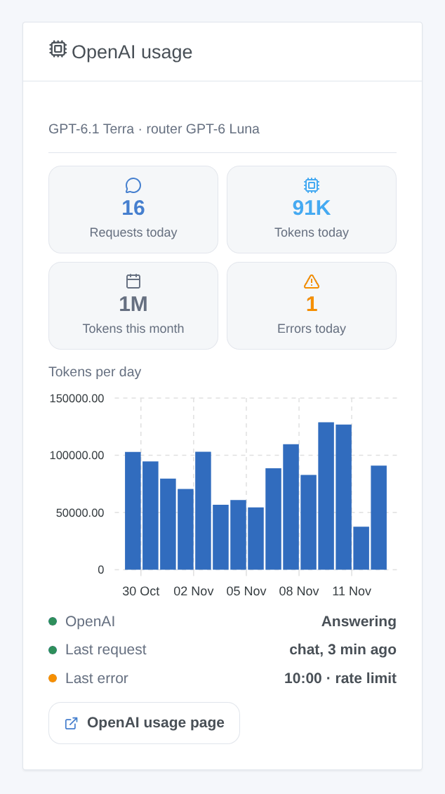

# OpenAI

## Overview

This integration runs the assistant of Gladys on the **GPT models of OpenAI**, through the official OpenAI API (Responses API) and your own API key. Once you choose it in **Settings → Artificial Intelligence**, every AI request of Gladys goes to OpenAI: the chat and the devices it controls, the scenes it creates, the "ask the AI" scene action and the weekly digest. It works without a Gladys Plus account: you pay OpenAI directly, per use.

It also adds two scene triggers (the assistant fails, the assistant answers again) and a dashboard widget of your consumption.

Not affiliated with OpenAI. Not tested with a real OpenAI key yet: feedback welcome.

## Prerequisites

- Gladys Assistant 5.3.0 or later.
- An account on the [OpenAI platform](https://platform.openai.com) with prepaid credits (Billing), and an API key: **API keys**, **Create new secret key** (a project key is enough).
- **Costs**: billed per token. With the default models, a chat turn costs a fraction of a cent; the reasoning tokens count as output. Set a monthly budget and spend limits in **Limits**: the integration then stops cleanly when they are reached.
- **Your data**: OpenAI does not train its models on API data unless you opt in. The integration sends every request with storage off (`store: false`), but OpenAI keeps abuse monitoring logs for up to 30 days.
- What leaves your home: every chat message, the history, the tools Gladys offers and their results (the state of the devices the model reads) and the chat images go to OpenAI over HTTPS. The answers control your devices and create scenes.

## Configuration

| Field or button                | Default       | Meaning                                                                                       |
| ------------------------------ | ------------- | --------------------------------------------------------------------------------------------- |
| OpenAI API key                 | —             | Required. Never shown again, never logged                                                     |
| Chat model                     | GPT-6.1 Terra | Answers the chat, creates scenes, writes the weekly digest                                    |
| Router model                   | GPT-6 Luna    | Sorts every message before the answer and must reply within 20 seconds                        |
| Other model id                 | —             | Only when a model is set to "Other model": the exact API id (it must call tools in Responses) |
| Reasoning of the chat model    | Low           | More reasoning, better scenes, slower and costlier answers                                    |
| Maximum answer length (tokens) | 16000         | Reasoning included; OpenAI advises 25000 to try high reasoning                                |
| Test the connection            | —             | One short answer from each model with its time; spends a few tokens                           |

The status of the configuration screen says whether OpenAI accepts the key and both models, without spending a token. Reading a model does not prove that the project can pay (no credit left, spend limit): **Test the connection** does.

## Usage

1. Integrations → **OpenAI** → Configuration: paste the API key, keep the default models, press **Test the connection**.
2. Settings → **Artificial Intelligence**: choose **OpenAI**.
3. Talk to Gladys in the chat: "turn on the living room", "what is the temperature in the bedroom?", "create a scene that closes the shutters at sunset".

### Choosing the models

Prices per million tokens, input / output, on 5 November 2026:

- **GPT-6.1 Terra** (default for the chat, $1 / $5): fast, good at calling tools and at clear writing.
- **GPT-6.1 Sol** ($2 / $10): close to Astra for complex requests.
- **GPT-6 Astra** ($10 / $50): the most capable, for long scene descriptions.
- **GPT-6 Luna** (default router, $0.10 / $0.50): the fastest and cheapest; less reliable to create scenes.
- **GPT-5.6 Terra** and **GPT-5.6 Luna**: the previous generation, still supported.
- **Other model**: a newer model or a dated snapshot. If it refuses the reasoning effort, the integration sends it without from then on.

GPT-6.1 Sol and GPT-6 Astra cannot turn reasoning off: **None** becomes **low** for them. The router always uses the least reasoning its model accepts.

### Dashboard widget

The **OpenAI usage** widget shows the requests and tokens of the day, the tokens of the month, the errors of the day, the tokens per day over 30 days, whether OpenAI answers, the last request and the last error. It counts what Gladys asked, reasoning included; the Usage page of the OpenAI platform stays the reference for the bill.

### Scenes

- **Trigger "OpenAI: the assistant fails"**: once per failure (key refused, credits or spend limit, rate limit, model unavailable, API unreachable, too slow, OpenAI error), with the kind, the message, the request and the model.
- **Trigger "OpenAI: the assistant answers again"**: the first answer after a failure, with the minutes of failure.

Examples: when the assistant fails because of credits or the spend limit, send a Telegram message to the administrator; when it answers again, send another one with the minutes of failure.

There is no web search action: OpenAI requires web results to be shown with their sources as prominent, clickable links, which a scene notification cannot guarantee.

## Troubleshooting

- **"OpenAI refused the API key"**: copy the key again from the API keys page; a revoked key gives the same message. The same message appears when Gladys runs in a country OpenAI does not serve.
- **"OpenAI refuses to run …: no credit left or spend limit reached"**: add credits in Billing, or raise the budget in Limits. Waiting does not help: the integration does not retry.
- **"Rate limit reached"**: the limits depend on the usage tier of the account and rise as you spend. A chat turn makes at least two requests.
- **"… is not available to this API key"**: the model does not exist, was shut down, or the project has no access to it; choose another one.
- **The chat answers without doing anything**: try GPT-6.1 Terra or 6.1 Sol with low or medium reasoning; GPT-6 Luna is less reliable with many tools.
- **"The answer was cut at max_tokens"**: raise the maximum answer length, or lower the reasoning.
- **"… refused to answer"** or **"content_filter"**: OpenAI's safety systems blocked the request or the answer; rephrase it.
- Logs: Settings → Supervision, the logs of the integration. Never share your API key.
