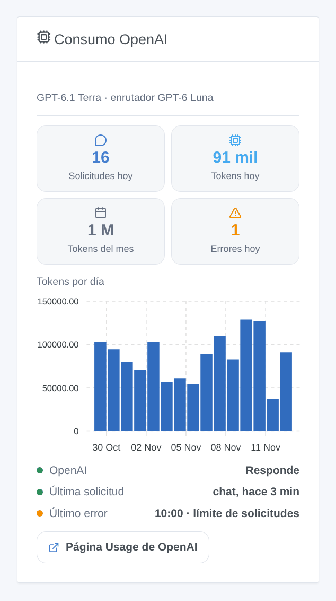

# OpenAI

## Presentación

Esta integración hace funcionar el asistente de Gladys con los **modelos GPT de OpenAI**, a través de la API oficial de OpenAI (API Responses) y su propia clave de API. Una vez elegida en **Ajustes → Inteligencia artificial**, cada solicitud de IA de Gladys va a OpenAI: el chat y los dispositivos que controla, las escenas que crea, la acción de escena «preguntar a la IA» y el resumen semanal. Funciona sin cuenta de Gladys Plus: usted paga a OpenAI directamente, por uso.

También añade dos desencadenantes de escena (el asistente falla, el asistente vuelve a responder) y un widget de panel de su consumo.

Sin afiliación con OpenAI. Todavía no probada con una clave real de OpenAI: sus comentarios son bienvenidos.

## Requisitos previos

- Gladys Assistant 5.3.0 o posterior.
- Una cuenta en la [plataforma de OpenAI](https://platform.openai.com) con créditos prepagados (Billing) y una clave de API: **API keys**, **Create new secret key** (basta con una clave de proyecto).
- **Costes**: facturación por token. Con los modelos por defecto, un intercambio del chat cuesta una fracción de céntimo; los tokens de razonamiento cuentan como salida. Fije un presupuesto mensual y límites de gasto en **Limits**: la integración se detiene entonces de forma limpia cuando se alcanzan.
- **Sus datos**: OpenAI no entrena sus modelos con los datos de la API salvo que usted lo acepte. La integración envía cada solicitud sin almacenamiento (`store: false`), pero OpenAI conserva registros de supervisión de abusos hasta 30 días.
- Lo que sale de su casa: cada mensaje del chat, el historial, las herramientas que Gladys ofrece y sus resultados (el estado de los dispositivos que el modelo consulta) y las imágenes del chat van a OpenAI por HTTPS. Las respuestas controlan sus dispositivos y crean escenas.

## Configuración

| Campo o botón                             | Por defecto   | Función                                                                                                    |
| ----------------------------------------- | ------------- | ---------------------------------------------------------------------------------------------------------- |
| Clave de API de OpenAI                    | —             | Obligatoria. Nunca se vuelve a mostrar ni se registra                                                      |
| Modelo del chat                           | GPT-6.1 Terra | Responde al chat, crea escenas, redacta el resumen semanal                                                 |
| Modelo del enrutador                      | GPT-6 Luna    | Clasifica cada mensaje antes de la respuesta y debe contestar en menos de 20 segundos                      |
| Identificador del otro modelo             | —             | Solo cuando un modelo está en «Otro modelo»: el identificador exacto (debe llamar herramientas, Responses) |
| Razonamiento del modelo del chat          | Bajo          | Más razonamiento, mejores escenas, respuestas más lentas y caras                                           |
| Longitud máxima de una respuesta (tokens) | 16000         | Razonamiento incluido; OpenAI aconseja 25000 para probar un razonamiento alto                              |
| Probar la conexión                        | —             | Una respuesta corta de cada modelo con su tiempo; consume algunos tokens                                   |

El estado de la pantalla de configuración indica si OpenAI acepta la clave y los dos modelos, sin consumir ningún token. Leer un modelo no demuestra que el proyecto pueda pagar (sin crédito, límite de gasto): **Probar la conexión**, sí.

## Uso

1. Integraciones → **OpenAI** → Configuración: pegue la clave de API, mantenga los modelos por defecto y pulse **Probar la conexión**.
2. Ajustes → **Inteligencia artificial**: elija **OpenAI**.
3. Hable con Gladys en el chat: «enciende el salón», «¿qué temperatura hace en el dormitorio?», «crea una escena que cierre las persianas al atardecer».

### Elegir los modelos

Precios por millón de tokens, entrada / salida, a 5 de noviembre de 2026:

- **GPT-6.1 Terra** (por defecto para el chat, 1 $ / 5 $): rápido, bueno llamando herramientas y redactando con claridad.
- **GPT-6.1 Sol** (2 $ / 10 $): cercano a Astra para las peticiones complejas.
- **GPT-6 Astra** (10 $ / 50 $): el más capaz, para descripciones largas de escenas.
- **GPT-6 Luna** (enrutador por defecto, 0,10 $ / 0,50 $): el más rápido y barato; menos fiable para crear escenas.
- **GPT-5.6 Terra** y **GPT-5.6 Luna**: la generación anterior, todavía compatible.
- **Otro modelo**: un modelo más reciente o una versión fechada. Si rechaza el esfuerzo de razonamiento, la integración lo envía sin él a partir de entonces.

GPT-6.1 Sol y GPT-6 Astra no pueden desactivar el razonamiento: **Ninguno** pasa a **bajo** para ellos. El enrutador usa siempre el menor razonamiento que acepta su modelo.

### Widget del panel

El widget **Consumo OpenAI** muestra las solicitudes y tokens del día, los tokens del mes, los errores del día, los tokens por día durante 30 días, si OpenAI responde, la última solicitud y el último error. Cuenta lo que Gladys ha pedido, razonamiento incluido; la página Usage de la plataforma de OpenAI sigue siendo la referencia para la factura.

### Escenas

- **Desencadenante «OpenAI: el asistente falla»**: una vez por fallo (clave rechazada, créditos o límite de gasto, límite de solicitudes, modelo no disponible, API inaccesible, demasiado lento, error de OpenAI), con el tipo, el mensaje, la solicitud y el modelo.
- **Desencadenante «OpenAI: el asistente vuelve a responder»**: la primera respuesta tras un fallo, con los minutos de fallo.

Ejemplos: cuando el asistente falla por los créditos o el límite de gasto, enviar un mensaje de Telegram al administrador; cuando vuelve a responder, enviar otro con los minutos de fallo.

No hay acción de búsqueda web: OpenAI exige mostrar los resultados web con sus fuentes como enlaces visibles y pulsables, algo que una notificación de escena no puede garantizar.

## Solución de problemas

- **«OpenAI ha rechazado la clave de API»**: vuelva a copiar la clave desde la página API keys; una clave revocada da el mismo mensaje. El mismo mensaje aparece cuando Gladys funciona en un país que OpenAI no atiende.
- **«OpenAI se niega a ejecutar …: no queda crédito o se ha alcanzado el límite de gasto»**: añada créditos en Billing o suba el presupuesto en Limits. Esperar no sirve: la integración no lo reintenta.
- **«Se ha alcanzado el límite de solicitudes»**: los límites dependen del nivel de uso de la cuenta y suben con su gasto. Un intercambio del chat hace al menos dos solicitudes.
- **«… no está disponible para esta clave de API»**: el modelo no existe, se ha retirado o el proyecto no tiene acceso; elija otro.
- **El chat responde sin hacer nada**: pruebe GPT-6.1 Terra o 6.1 Sol con un razonamiento bajo o medio; GPT-6 Luna es menos fiable con muchas herramientas.
- **«The answer was cut at max_tokens»**: aumente la longitud máxima de una respuesta o reduzca el razonamiento.
- **«… refused to answer»** o **«content_filter»**: los sistemas de seguridad de OpenAI han bloqueado la petición o la respuesta; reformúlela.
- Registros: Ajustes → Supervisión, los registros de la integración. No comparta nunca su clave de API.
